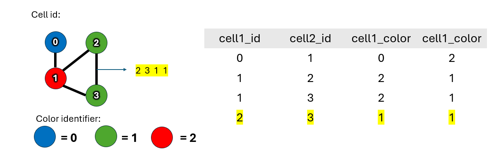
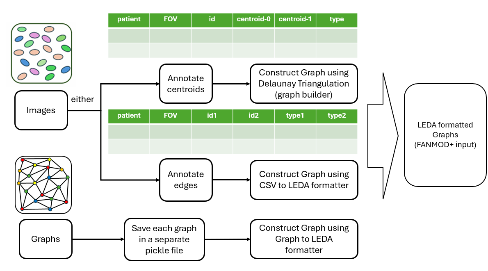
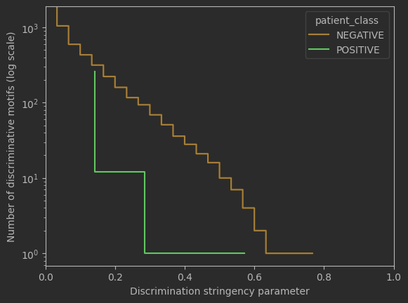

# Context-dependent Identification of Spatial Motifs (CISM)

### Description
Python package contains the code and a demo notebook on public dataset MIBITOF-TNBC (Keren, Leeat et al.
Cell, Volume 174, Issue 6, 1373 - 1387.e19).)

CISM is a two-step method to identify local interconnected cell structures associated with a disease state in single cell spatial proteomics data.

## Analysis table of contents

Use this table to find the code for each paper-revision analysis. Each topic folder has a README listing its scripts. The [detailed analysis index](analysis/README.md) includes execution guidance, and [source_layout.json](analysis/source_layout.json) maps the original source paths to the organized locations.

| Analysis | What it covers | Location |
| --- | --- | --- |
| Absent and underrepresented motifs | Class-depleted motifs, two-tailed significance, motif composition, and stringency tradeoffs. | [analysis/absent_motifs/](analysis/absent_motifs/) |
| Parameter robustness and uncertainty | Motif-size and stringency sensitivity, execution variability, motif recovery, patient-bootstrap uncertainty, and CRC/TNBC extensions. | [analysis/cism_robustness_revision/](analysis/cism_robustness_revision/) |
| Cohort imbalance | Patient-class imbalance, bootstrap stringency selection, and stability of motif unions across folds. | [analysis/cohort_imbalance/](analysis/cohort_imbalance/) |
| CosMx dataset preparation | cSCC and HNSCC metadata preparation, RNA subtype reconstruction, screening subsets, and CISM pipeline code. | [analysis/cosmx_preparation/](analysis/cosmx_preparation/) |
| CRC characterization | Cell-type frequencies and hierarchy, motif composition, pairwise interactions, original-label reconstruction, and singleton classifier controls. | [analysis/crc_characterization/](analysis/crc_characterization/) |
| Marker ownership and unidentified cells | Marker attribution, spillover, unidentified-cell neighborhood enrichment, HEV/mECA79 motif examples, and microscopy figure code. | [analysis/marker_ownership/](analysis/marker_ownership/) |
| Melanoma characterization | Motif prevalence, instance distances and scores, fixed-stringency analyses, and supplementary-table preparation. | [analysis/melanoma_characterization/](analysis/melanoma_characterization/) |
| Patient motif clustering | FANMOD patient-motif clustering, PCA, k-means, disease-state associations, and cluster figure code. | [analysis/motif_clustering/](analysis/motif_clustering/) |
| Noise robustness | FANMOD perturbation and retrial comparisons, motif-induced cell/pair distributions, and robustness summaries. | [analysis/noise_robustness/](analysis/noise_robustness/) |
| Patient-level composition and interactions | Patient-level cell-type composition and interaction tests, hierarchical spatial null models, and independent validation. | [analysis/patient_level_validation/](analysis/patient_level_validation/) |
| Patient-label permutation controls | CRC, TNBC, and melanoma permutation tests, matched classifier evaluation, aggregation, and control figures. | [analysis/permutation_controls/](analysis/permutation_controls/) |
| SMORE comparison | Matched SMORE/CISM cohorts and evaluation, MATLAB compatibility code, timing, result audits, and comparison figures. | [analysis/smore_comparison/](analysis/smore_comparison/) |
| Spatial and tissue density | Motif density, tissue density, edge correction, nearest-neighbor comparisons, and spatial point-null sensitivity. | [analysis/spatial_density/](analysis/spatial_density/) |
| Field-of-view scale and resolution | Cropped and split FOV experiments, cell counts, spatial resolution, stringency, and motif retention. | [analysis/spatial_scale/](analysis/spatial_scale/) |
| Multiclass melanoma classification | One-vs-one and one-vs-all confidence stacking, motif panels, cohort variants, and evaluation. | [multi_class/](multi_class/) |
| Graph neural network comparison | Graph data preparation, GCN classification, and explanation code. | [GCN/](GCN/) |

### Notebooks and tutorials

| Notebook or collection | Purpose | Location |
| --- | --- | --- |
| General CISM tutorials | Data preparation, FANMOD initialization, analysis of serialized CISM objects, and soft motif selection. | [tutorials/](tutorials/) |
| Melanoma tutorials | Melanoma preparation, initialization, motif selection, lasso refinement, and motif frequencies. | [melanoma_tutorials/](melanoma_tutorials/) |
| CRC notebook | CRC cohort analysis and motif discovery. | [CISM_on_CRC.ipynb](CISM_on_CRC.ipynb) |
| Motif cell-type distribution | Cell-type distributions within motifs. | [in_motif_cell_type_distribution.ipynb](in_motif_cell_type_distribution.ipynb) |
| Melanoma classification notebook | Notebook-based melanoma classification analysis. | [melanoma classification.ipynb](melanoma%20classification.ipynb) |
| Unidentified-cell post-processing | Post-processing and cluster characterization of unidentified cells. | [unidentified_post_process.ipynb](unidentified_post_process.ipynb) |
| Imbalance results notebook | Inspection of saved bootstrap imbalance and stringency results. | [imbalanced_bootstrap_results.ipynb](analysis/cohort_imbalance/imbalanced_bootstrap_results.ipynb) |
| Multiclass results notebook | Inspection of saved multiclass classification results. | [results.ipynb](multi_class/results.ipynb) |

The shared implementation lives in [cism/](cism/), pairwise comparison code in [pairwise/](pairwise/), and regression tests in [tests/](tests/).

This branch includes code, usage documentation, and notebooks with saved outputs cleared. Input datasets, serialized objects, intermediate results, generated plots/reports, shell scripts, and scheduler launchers are excluded from the revision additions. Some analyses require external data or historical saved results; see the topic READMEs and script arguments before running them.

### Installation and Dependencies

#### Prerequisite

1. Python 3.9
2. FANMOD+ binary (https://github.com/zaritskylab/FANMODPlus)

#### Prepare virtual environment

1. python3 -m venv venv
2. activate venv (windows: venv\Scripts\activate, linux:source venv/bin/activate)
3. python3 -m pip install requests
4. python3 -m pip install -r requirements.txt
5. python3 -m pip install -e .

### 3-step pipeline
The package now exposes the workflow as:

1. `data_preparation` - make the dataset compatible with FANMOD+ and CISM
2. `initialization` - run FANMOD+ and initialize CISM class with the configuration and dataset
3. `analysis` - analyze CISM outputs

Notebook tutorials live at the repository level, outside the `cism` package itself.
The first tutorial notebooks are:

- `tutorials/01_data_preparation.ipynb`
- `tutorials/02_fanmod_and_cism_initialization.ipynb`
- `tutorials/03b_soft_motif_selection.ipynb`
- `tutorials/03_analysis_from_serialized_cism.ipynb`

`03b_soft_motif_selection.ipynb` starts from the serialized artifact created by tutorial 02 and ranks motifs with the multi-objective soft motif selection framework.

### Prepare dataset for analysis
In order to analyze the proteomics data, we need to convert each patient's field of view (FOV) to a graph and store the graphs in a folder.

For FANMOD+ to work properly and later provide the necessary information for CISM, , we need to convert each patient's field of view (FOV) to a graph and store the graphs in a folder.
The graph should specifically be in the format of colored edge list in the following format:

Folder structure (with 1..n patients and 1..f field-of-view):
- data
  - Dataset Name
    - Patient_1_FOV1.txt
    - Patient_2_FOV2.txt
    - ...
    - ...
    - Patient_\<n>_FOV\<f>.txt
    - patient_class.csv

each txt file represents a field of view (FOV) of a patient and should be in the following format:

#### Patient_\<i>_FOV\<k>.txt format (LEDA)
Each field-of-view file should be in the following format:

`<src cell id> <dst cell id> <src cell color id> <dst cell color id>
.....
<src cell id> <dst cell id> <src cell color id> <dst cell color id>`

For example assume the following graph:

The preparation layer supports three routes into FANMOD/CISM-compatible network files:

- annotated centroid tables &rarr; graph builder &rarr; colored edge LEDA txt files
- annotated edge tables &rarr; colored edge LEDA txt files
- prebuilt `networkx` graphs &rarr; graph files &rarr; colored edge LEDA txt files

#### patient_class.csv format
CISM method support two classes type:
1. Binary (string)
2. Continues (int/float) -> later on will be quantized to binary

The format of each patient class:

    <disease tag><patient id>, <class>

For example:

    TNBC1, POSITIVE
    TNBC2, NEGATIVE

or when the class is a continuous value of survival days:

    TNBC1, 2612
    TNBC2, 3822

### Find discriminative motifs in nutshell
##### TL;DR For more comprehensive explanation please refer to TNBC notebook Tutrial under anlysis folder [Notebook](./analysis/Tutorial/mibitof_tnbc_tutorial.ipynb)

#### Initiate CISM class with the configuration:

    cism = CISM(fanmod_exe=<fanmod+ binary name>,
                fanmod_path=<fanmod+ path>,
                network_dataset_root_path=<the path to datasets root dir>,
                fanmod_output_root_path=<fanmod+ output directory>,
                fanmod_cache_root_path=<fanmod+ postprocessing directory>,
                motif_size=<motif size>,
                iterations=<number of random networks for subgraph significant check>)

#### Loading dataset:

    cism.add_dataset(dataset_folder=<relative dataset folder>, 
                     dataset_type=<dataset type name>, 
                     dataset_name=<dataset name>, 
                     force_run_fanmod=<whether to override fanmod+ existing results>, 
                     force_parse=<whether to override existing parse files of fanmod+ outputs>, 
                     n_jobs=<number of jobs allows running in parallel>)

`add_dataset(...)` now validates the raw dataset contract before FANMOD starts:

- network files must be named `Patient_<patient_id>_FOV<fov>.txt`
- each non-empty row must have `src_id dst_id src_type_id dst_type_id`
- node type ids must be integers
- `patient_class.csv` can be required explicitly when a workflow depends on it

### Data preparation entry points

    from cism import prepare_from_centroids, prepare_from_edge_annotations, prepare_from_graphs

    result = prepare_from_centroids(
        dataframe=<centroid dataframe>,
        path_to_output_dir=<dataset directory>,
        column_mapping={
            "patient_id": "SampleID",
            "cell_type": "cell type",
        },
        cell_type_mapper=<optional mapper or None>,
        max_distance=100,
    )

All preparation routes normalize column names on a copy first, so downstream code always sees the canonical schema.

#### Initiate discriminator:

    discriminator = TissueStateDiscriminativeMotifs(cism=<CISM object>,
                                                    tissue_state_csv_path=<path to patient class csv file>,
                                                    tissue_state_to_string=<for binary class, dict from raw class to string>,
                                                    common_cells_type=<cell types dict>,
                                                    tissue_state_func=<for continues class type, function that map int/float to class>)

    In case of continues class type (see above), tissue_state_to_string should set to None.

    common_cells_type: the format of the dictionary mapping

    cells_type = {
     <network color id>: <cell type name>,
     ....
     ....
     <network color id>: <cell type name>,
    }

#### Direct discovery of discriminative motifs (without leave-one-out process):

    discover_result = discriminator.discover(extract_by=<DiscriminativeFeatureKey>, 
                                             classes=<list of classes>)
    
extract_by with DiscriminativeFeatureKey.STRUCTURE_AND_CELL_IDENTITIES use motif canonical representation to discriminate.

#### Multi-objective soft motif selection:

    from cism import (
        MotifSelectionWeights,
        SoftMotifSelectionConfig,
        StabilityGateConfig,
        evaluate_soft_motif_selection_loocv,
        score_soft_motifs_from_discriminator,
    )

    selection_config = SoftMotifSelectionConfig(
        labels=["POSITIVE", "NEGATIVE"],
        top_k=10,
        weights=MotifSelectionWeights(effect=2.0, abundance=1.0, prevalence=1.0, confidence=1.0, dispersion=0.5),
        gate=StabilityGateConfig(tau=0.6, gamma=2.0),
    )

    soft_result = score_soft_motifs_from_discriminator(discriminator, selection_config)
    loocv_result = evaluate_soft_motif_selection_loocv(discriminator, selection_config)

The soft selector ranks motif `ID` features by effect size, abundance, prevalence, statistical confidence, dispersion desirability, and a multiplicative LOOCV stability gate.

#### Plot number of discriminative motifs versus discrimination stringency parameter:

    discover_result.plot_number_of_motifs_versus_discrimination_stringency_parameter(class_to_color=<dict dieases class to color>)

#### Show summary table of all the extracted discrimination motifs
discover_result.discriminative_motifs will plot the full dataframe with all the extracted discriminative motifs
    
    idx,Patient,FOV,ID,Freq,Count,Mean_Freq,STD,z_score,p_value,motif,nunique_colors,Disease,Patient_uId,colors_vec,colors_vec_hash,patient_class,patient_count,patient_percentage
    3,10,FOV10,7722444,0.025521,1321,0.019233,0.000694,9.0653,0.000,gASVMAEAAAAAAACMGG5ldHdvcmt4LmNsYXNzZXMuZGlncmFwaJSMB0RpR3JhcGiUk5QpgZR9lCiMBWdyYXBolH2UjAVfbm9kZZR9lChLAX2UjAR0eXBllIwBM5RzSwJ9lGgKjAIxNJRzSwN9lGgKjAIxNJRzdYwEX2FkapR9lChLAX2USwJ9lIwFbGFiZWyUjACU...,2,TNBC,TNBC10,"[0, 0, 0, 1, 0, 0, 0, 0, 0, 0, 0, 0, 0, 0, 2, 0]",-3729389300718233172,NEGATIVE,4,0.133333
    10,10,FOV10,26596812,0.007419,384,0.003551,0.000309,12.5370,0.000,gASVMQEAAAAAAACMGG5ldHdvcmt4LmNsYXNzZXMuZGlncmFwaJSMB0RpR3JhcGiUk5QpgZR9lCiMBWdyYXBolH2UjAVfbm9kZZR9lChLAX2UjAR0eXBllIwCMTKUc0sCfZRoCowCMTSUc0sDfZRoCowCMTSUc3WMBF9hZGqUfZQoSwF9lEsCfZSMBWxhYmVslIwA...,2,TNBC,TNBC10,"[0, 0, 0, 0, 0, 0, 0, 0, 0, 0, 0, 0, 1, 0, 2, 0]",-4991885778241402576,NEGATIVE,4,0.133333
    63,10,FOV10,5592396,0.000966,50,0.000581,0.000112,3.4252,0.000,gASVMAEAAAAAAACMGG5ldHdvcmt4LmNsYXNzZXMuZGlncmFwaJSMB0RpR3JhcGiUk5QpgZR9lCiMBWdyYXBolH2UjAVfbm9kZZR9lChLAX2UjAR0eXBllIwBMpRzSwJ9lGgKjAIxMJRzSwN9lGgKjAIxMJRzdYwEX2FkapR9lChLAX2USwJ9lIwFbGFiZWyUjACU...,2,TNBC,TNBC10,"[0, 0, 1, 0, 0, 0, 0, 0, 0, 0, 2, 0, 0, 0, 0, 0]",-774791192153669712,NEGATIVE,9,0.300000
    94,10,FOV10,6048076,0.000657,34,0.000203,0.000072,6.2723,0.000,gASVLQEAAAAAAACMGG5ldHdvcmt4LmNsYXNzZXMuZGlncmFwaJSMB0RpR3JhcGiUk5QpgZR9lCiMBWdyYXBolH2UjAVfbm9kZZR9lChLAX2UjAR0eXBllIwBMpRzSwJ9lGgKaAtzSwN9lGgKjAIxMJRzdYwEX2FkapR9lChLAX2UKEsCfZSMBWxhYmVslIwAlHNL...,2,TNBC,TNBC10,"[0, 0, 2, 0, 0, 0, 0, 0, 0, 0, 1, 0, 0, 0, 0, 0]",1304415446218764995,NEGATIVE,12,0.400000
    111,10,FOV10,18199980,0.000502,26,0.000052,0.000055,8.1978,0.000,gASVMAEAAAAAAACMGG5ldHdvcmt4LmNsYXNzZXMuZGlncmFwaJSMB0RpR3JhcGiUk5QpgZR9lCiMBWdyYXBolH2UjAVfbm9kZZR9lChLAX2UjAR0eXBllIwBOJRzSwJ9lGgKjAIxM5RzSwN9lGgKjAIxM5RzdYwEX2FkapR9lChLAX2USwJ9lIwFbGFiZWyUjACU...,2,TNBC,TNBC10,"[0, 0, 0, 0, 0, 0, 0, 0, 1, 0, 0, 0, 0, 2, 0, 0]",-1039844095083563261,NEGATIVE,6,0.200000
    139,10,FOV10,13981004,0.000425,22,0.000145,0.000053,5.3096,0.000,gASVMAEAAAAAAACMGG5ldHdvcmt4LmNsYXNzZXMuZGlncmFwaJSMB0RpR3JhcGiUk5QpgZR9lCiMBWdyYXBolH2UjAVfbm9kZZR9lChLAX2UjAR0eXBllIwBNpRzSwJ9lGgKjAIxMJRzSwN9lGgKjAIxMJRzdYwEX2FkapR9lChLAX2USwJ9lIwFbGFiZWyUjACU...,2,TNBC,TNBC10,"[0, 0, 0, 0, 0, 0, 1, 0, 0, 0, 2, 0, 0, 0, 0, 0]",977771267870568768,NEGATIVE,8,0.266667
    150,10,FOV10,6113612,0.000406,21,0.000273,0.000078,1.6954,0.047,gASVMAEAAAAAAACMGG5ldHdvcmt4LmNsYXNzZXMuZGlncmFwaJSMB0RpR3JhcGiUk5QpgZR9lCiMBWdyYXBolH2UjAVfbm9kZZR9lChLAX2UjAR0eXBllIwBMpRzSwJ9lGgKjAIxMJRzSwN9lGgKjAIxMJRzdYwEX2FkapR9lChLAX2UKEsCfZSMBWxhYmVslIwA...,2,TNBC,TNBC10,"[0, 0, 1, 0, 0, 0, 0, 0, 0, 0, 2, 0, 0, 0, 0, 0]",-774791192153669712,NEGATIVE,4,0.133333
    158,10,FOV10,6118732,0.000386,20,0.000000,0.000000,,0.000,gASVTgEAAAAAAACMGG5ldHdvcmt4LmNsYXNzZXMuZGlncmFwaJSMB0RpR3JhcGiUk5QpgZR9lCiMBWdyYXBolH2UjAVfbm9kZZR9lChLAX2UjAR0eXBllIwBMpRzSwJ9lGgKjAIxMJRzSwN9lGgKjAIxMJRzdYwEX2FkapR9lChLAX2UKEsCfZSMBWxhYmVslIwA...,2,TNBC,TNBC10,"[0, 0, 1, 0, 0, 0, 0, 0, 0, 0, 2, 0, 0, 0, 0, 0]",-774791192153669712,NEGATIVE,8,0.266667
    189,10,FOV10,18701740,0.000309,16,0.000000,0.000000,,0.000,gASVTgEAAAAAAACMGG5ldHdvcmt4LmNsYXNzZXMuZGlncmFwaJSMB0RpR3JhcGiUk5QpgZR9lCiMBWdyYXBolH2UjAVfbm9kZZR9lChLAX2UjAR0eXBllIwBOJRzSwJ9lGgKjAIxMJRzSwN9lGgKjAIxM5RzdYwEX2FkapR9lChLAX2UKEsCfZSMBWxhYmVslIwA...,3,TNBC,TNBC10,"[0, 0, 0, 0, 0, 0, 0, 0, 1, 0, 1, 0, 0, 1, 0, 0]",-2188664753602309575,NEGATIVE,7,0.233333
    207,10,FOV10,11058348,0.000270,14,0.000005,0.000010,27.4310,0.000,gASVKgEAAAAAAACMGG5ldHdvcmt4LmNsYXNzZXMuZGlncmFwaJSMB0RpR3JhcGiUk5QpgZR9lCiMBWdyYXBolH2UjAVfbm9kZZR9lChLAX2UjAR0eXBllIwBNZRzSwJ9lGgKaAtzSwN9lGgKaAtzdYwEX2FkapR9lChLAX2USwN9lIwFbGFiZWyUjACUc3NLAn2U...,1,TNBC,TNBC10,"[0, 0, 0, 0, 0, 3, 0, 0, 0, 0, 0, 0, 0, 0, 0, 0]",-3622911041628419534,NEGATIVE,15,0.500000
    ....
    ....

##### For more comprehensive explanation please refer to TNBC notebook demo under the demo folder [Notebook](./analysis/Tutorial/mibitof_tnbc_tutorial.ipynb)
